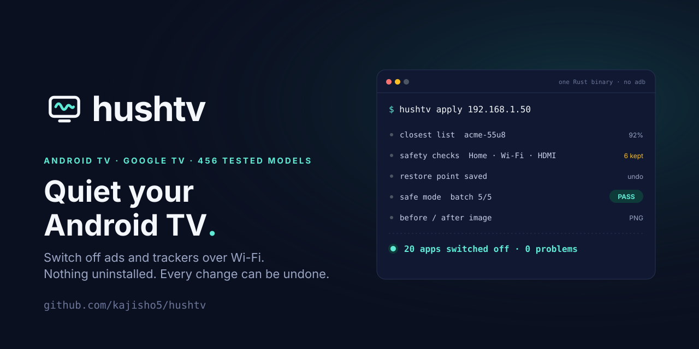
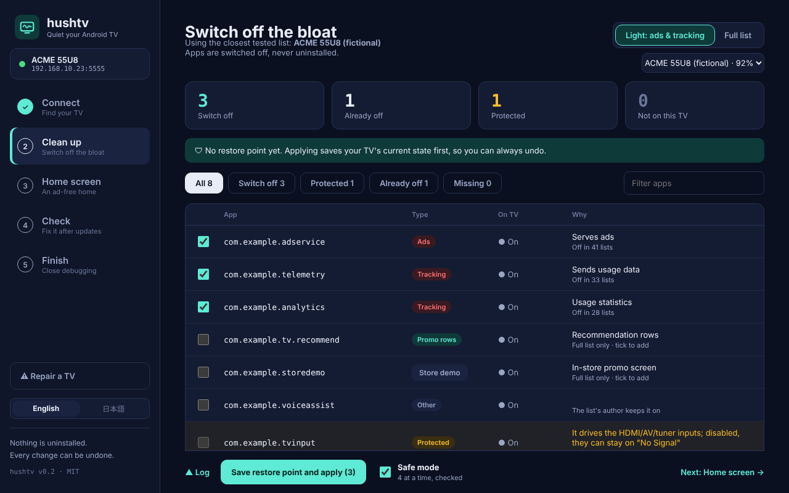
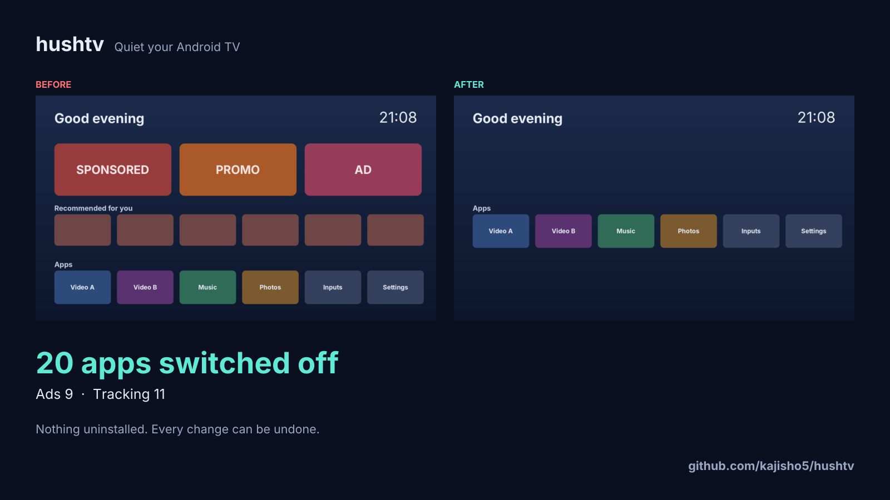
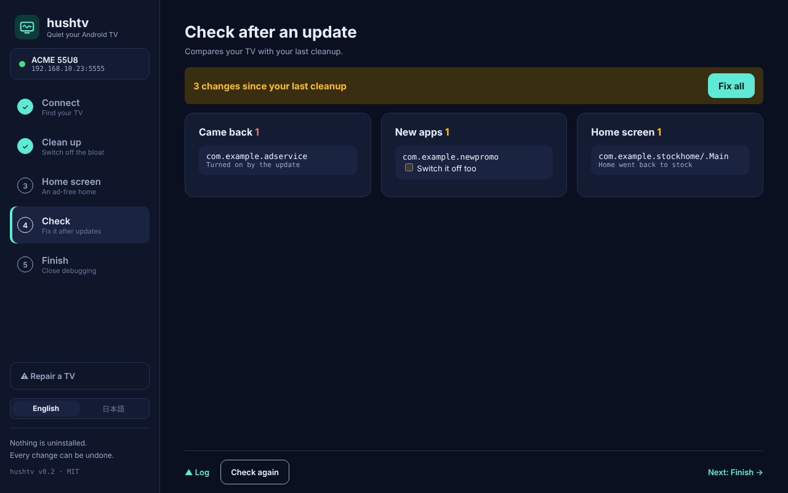
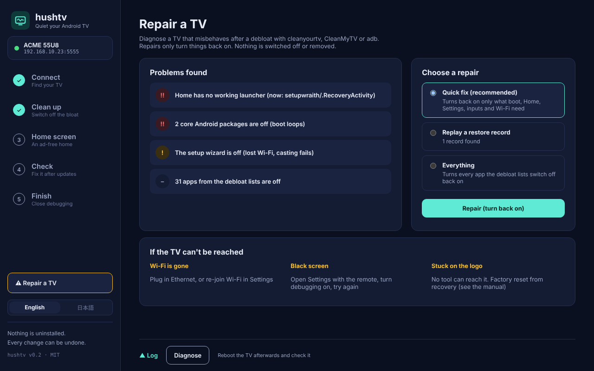
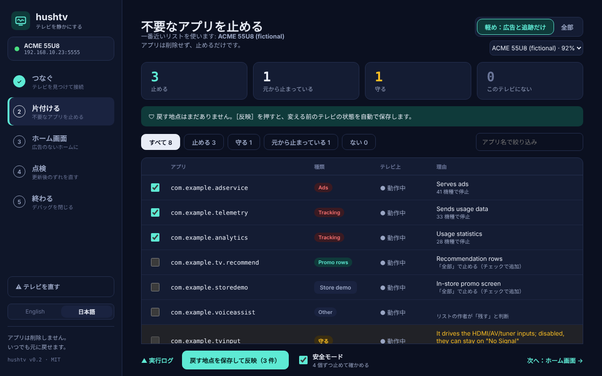
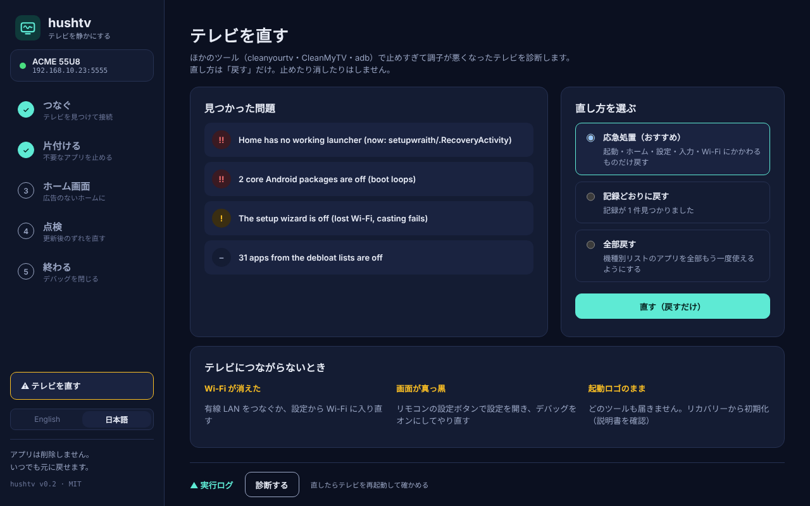

<p align="center">
  <picture>
    <source media="(prefers-color-scheme: dark)" srcset="brand/logo/hushtv-horizontal-on-dark.svg">
    
  </picture>
</p>

<p align="center"><b>Quiet your Android TV.</b><br>
Switch off the ads, trackers and promo rows that ship on Android TV and Google TV, over Wi-Fi.<br>
Nothing uninstalled · Every change can be undone · One Rust app, no adb</p>

<p align="center">
  <a href="https://github.com/kajisho5/hushtv/releases"><b>Download</b></a> ·
  <a href="#quick-start"><b>Quick start</b></a> ·
  <a href="#safety">Safety</a> ·
  <a href="docs/RESCUE.md">Repair a TV</a> ·
  <a href="#command-line">Command line</a> ·
  <a href="#日本語">日本語</a>
</p>

<p align="center">
  <a href="https://github.com/kajisho5/hushtv/actions/workflows/ci.yml"></a>
  <a href="https://github.com/kajisho5/hushtv/releases"></a>
  
  
  <a href="LICENSE"></a>
</p>

<p align="center">
  <a href="https://github.com/kajisho5/hushtv/releases"></a>
</p>

> **Status: v0.2.0-beta.6.** The safety rules are ported from cleanyourtv and covered by tests, and the app has been run on Linux, but **hushtv has not been tried on a real TV yet**. Look at the plan before you apply, keep the restore point, and please [report how it went](https://github.com/kajisho5/hushtv/issues/new?template=tv-report.yml).

<table>
  <tr>
    <td width="50%"><br><sub><b>Clean up.</b> Light switches off only ads and tracking. Unsafe apps are locked.</sub></td>
    <td width="50%"><br><sub><b>Share.</b> hushtv photographs the home screen before and after. (Sample made from fictional screens.)</sub></td>
  </tr>
  <tr>
    <td width="50%"><br><sub><b>Check.</b> After a firmware update, see what came back and fix it in one click.</sub></td>
    <td width="50%"><br><sub><b>Repair.</b> Fixes TVs another tool broke. It only turns things back on.</sub></td>
  </tr>
</table>

---

## Why

Android TV ships with sponsored rows, ad services, usage reporting and store demos you can't remove from the menus. The knowledge to switch them off safely already exists: [cleanyourtv](https://github.com/Gathin23/cleanyourtv) has tested lists for **456 TV models from 122 brands** and the safety rules that keep a TV bootable. Using it means Python, a JDK and the Android SDK. [CleanMyTV](https://github.com/wingedpanther/cleanmytv) made it a friendly desktop app, but it is Electron and downloads Google's `adb` for pairing.

hushtv puts both into one small Rust app:

- **No Python, no Java, no adb.** It speaks the ADB protocol itself ([adb_client](https://github.com/cocool97/adb_client)). The app is about 5 MB with every model list inside.
- **Light or Full.** Light, the default, switches off only ads and tracking. Full applies the whole tested list.
- **Safe mode, on by default.** Apps go off 4 at a time. After each batch hushtv checks that the TV still answers, Home still opens and Settings still opens. If not, that batch is turned back on and the run stops.
- **A restore point before every change**, in cleanyourtv's format, so either tool can undo it.
- **Check after firmware updates.** Updates quietly turn apps back on and reset Home. hushtv shows what drifted and fixes it.
- **Repair.** A TV that a debloat left without Home, Settings, HDMI or Wi-Fi gets diagnosed and fixed by turning things back on.
- **A before/after image** to show what changed.
- macOS, Windows and Linux, as an app or on the command line. English and Japanese.

## Quick start

1. **On the TV:** Settings → System → About → press **Build** 7 times. Then Developer options → turn on **USB debugging** and **Network debugging**.
2. **Download** the app for your computer from [Releases](https://github.com/kajisho5/hushtv/releases) and open it.
3. Pick your TV, accept **"Allow USB debugging?"** on the TV, look at the plan, and apply.
4. On the last screen, **Close debugging**. hushtv turns it off and checks that the port is closed.

The macOS app is signed and notarized by Apple (one dmg for Apple Silicon and Intel). The Windows installer is not signed yet: SmartScreen → More info → Run anyway.

## Safety

hushtv never uninstalls anything. Every app it touches is switched off with `pm disable-user --user 0` and can be turned back on.

Before anything is sent, the list goes through the same checks, in the same order, as cleanyourtv's `disable.sh`:

| Check | Why |
|---|---|
| Core Android and TV middleware | With these off, TVs have stopped booting. Never switched off, no override. |
| The setup wizard that owns your Wi-Fi | Switching it off deletes the saved network and the TV drops off Wi-Fi. |
| The app that owns Home | Without another launcher, Home goes black or the setup screen takes over. |
| HDMI and tuner drivers | Off, the inputs show "No Signal" until a full restore. |
| Apps that open inputs and Settings | Off, there is no way back to Developer options. |

Then safe mode checks the TV after every batch, the TV is read back to confirm what actually changed, and the restore point is already on disk.

## Repair a TV

```sh
hushtv rescue 192.168.1.50 --dry-run    # find problems, change nothing
hushtv rescue 192.168.1.50              # quick fix: boot, Home, Settings, inputs, Wi-Fi
hushtv rescue 192.168.1.50 --record     # replay a cleanyourtv, CleanMyTV or hushtv restore record
```

Works on TVs cleaned with any tool. It only turns things back on. See [docs/RESCUE.md](docs/RESCUE.md), including what to do when the TV can't be reached.

## Command line

The same engine, one file, for scripts, NAS boxes and weekly checks.

```sh
# macOS / Linux (Homebrew)
brew tap kajisho5/hushtv https://github.com/kajisho5/hushtv
brew install kajisho5/hushtv/hushtv        # command line
brew install --cask kajisho5/hushtv/hushtv-app   # the app (macOS)

# Windows (Scoop)
scoop bucket add hushtv https://github.com/kajisho5/hushtv
scoop install hushtv/hushtv
```

Or download `hushtv-*` from [Releases](https://github.com/kajisho5/hushtv/releases). The macOS command line is signed and notarized too.

```sh
hushtv scan                              # find TVs on your network
hushtv pair 192.168.1.50:37105 482913    # Wireless debugging: pair with the 6-digit code
hushtv info 192.168.1.50                 # model, Android version, closest lists
hushtv plan 192.168.1.50                 # what would change (changes nothing)
hushtv apply 192.168.1.50                # restore point, then Light in safe mode
hushtv apply 192.168.1.50 --preset full  # the whole tested list
hushtv check 192.168.1.50 --fix          # after a firmware update
hushtv restore 192.168.1.50              # undo everything
hushtv lists sony                        # search the 456 bundled lists
```

## Supported TVs

Any Android TV or Google TV whose Developer options include USB or Network debugging: Sony, TCL, Xiaomi, Philips, Sharp, Hisense (Google TV models), Nvidia Shield, Chromecast with Google TV and many more. Fire TV gets the clean-up only. TVs without ADB (Samsung Tizen, LG webOS, Roku, VIDAA) can't be supported.

## Not yet

- Installing the ad-free home screen.
- Applying one setup to many TVs at once.

## Build from source

```sh
cargo test --workspace
cargo build --release -p hushtv-cli                  # target/release/hushtv
npm ci --prefix ui && (cd crates/hushtv-app && ../../ui/node_modules/.bin/tauri build)
```

`crates/hushtv-core` holds everything that doesn't talk to the TV (lists, safety rules, plans, restore records, repair) and is where the tests live. `docs/DESIGN.md` is the design document; `scripts/brand/build_brand.py` rebuilds the logo, icons and social preview.

## Credits

The per-model lists and the safety rules come from [cleanyourtv](https://github.com/Gathin23/cleanyourtv) by Gathin (MIT) and are refreshed every week. The desktop flow is inspired by [CleanMyTV](https://github.com/wingedpanther/cleanmytv) by wingedpanther (MIT). ADB is spoken by [adb_client](https://github.com/cocool97/adb_client) (MIT). See [THIRD-PARTY-NOTICES.md](THIRD-PARTY-NOTICES.md).

## License

MIT

---

## 日本語

<p><b>Android TV / Google TV に最初から入っている広告・追跡・おすすめ欄のアプリを、パソコンから Wi-Fi 経由で止めます。</b>アプリは削除しません。全部元に戻せます。</p>

> **今の状態：v0.2.0-beta.6。** 安全装置は cleanyourtv から移してテストで確かめ、アプリは Linux で動かしています。ただし**実機のテレビではまだ試していません**。反映の前に中身を確かめ、戻す記録を残してください。使ってみたら[結果を教えてください](https://github.com/kajisho5/hushtv/issues/new?template=tv-report.yml)。

<table>
  <tr>
    <td width="50%"><br><sub>片付ける：軽め（広告と追跡だけ）／全部、安全モード</sub></td>
    <td width="50%"><br><sub>テレビを直す：ほかのツールで止めすぎたテレビを戻す</sub></td>
  </tr>
</table>

- **Python・Java・Google の adb は不要**。約 5MB のアプリに 456 機種のリストが入っています
- **軽め／全部**：既定の「軽め」は広告と追跡だけを止めます
- **安全モード（既定でオン）**：4 個ずつ止め、そのたびにテレビが答えるか・ホームと設定が開くかを確かめます。だめならその組を戻して止まります
- **変える前に必ず戻す記録を保存**（cleanyourtv と同じ形式）
- **ファーム更新のあとの点検**：戻ってきたアプリ・元に戻ったホームを見つけて直します
- **テレビを直す**：ほかのツールで止めすぎたテレビを、戻すだけで直します（[docs/RESCUE.md](docs/RESCUE.md)）
- **ビフォー・アフター画像**で変化を見せられます
- Mac・Windows・Linux。画面でもコマンドでも。英語と日本語

**使い方**

1. テレビで：設定 → デバイス設定 → 端末情報 →［ビルド］を 7 回 → 開発者向けオプション →［USB デバッグ］と［ネットワークデバッグ］をオン
2. [Releases](https://github.com/kajisho5/hushtv/releases) から自分のパソコン用のアプリをダウンロード
3. テレビを選び、テレビに出る「USB デバッグを許可しますか？」で［許可］、中身を確かめて反映
4. 最後の画面で［デバッグを閉じる］

**コマンドで入れる**：Mac・Linux は Homebrew、Windows は Scoop で入れられます（入れ方は上の「Command line」）。Mac のコマンド版も署名・公証済みです。

**日本のテレビ**：ソニー BRAVIA・シャープ AQUOS・TCL・シャオミなど Android TV / Google TV の機種が対象です（日本向けモデルのリストもあります）。パナソニック ビエラ（Fire TV）は止める部分だけ、ハイセンス（VIDAA）は対応できません。
